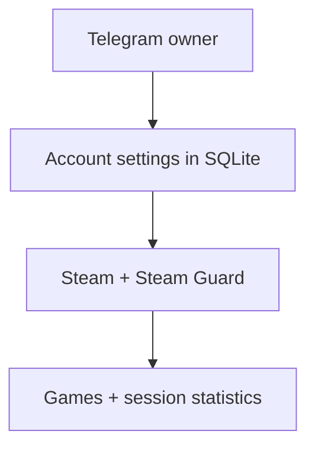

# 🎮 Steam Hour Booster

> Telegram control panel for Steam accounts: run games, Steam Guard, automatic reconnect, and session time tracking.

🌐 **Language / Язык:** [English](README.md) · [Русский](README_RU.md)


[](https://github.com/soroka01/HourBooster/actions/workflows/ci.yml)

## 📌 Overview

Steam Hour Booster is a Telegram bot for managing Steam accounts: it runs selected games, accepts Steam Guard codes, and tracks session time. Access is restricted to the owner; settings and statistics are stored in SQLite.

> [!WARNING]
> Passwords and the bot token are stored in the database in **plaintext**. See [Security & privacy](#-security--privacy).

> [!NOTE]
> The interface is available in English (default) and Russian: switch it with the 🌐 button on the main screen ([details](#language)).

## ✨ Features

- Account management entirely through Telegram: add, edit, delete (with confirmation).
- Start and stop games by App ID; game names are fetched from Steam and cached.
- Login via Steam AuthenticationService: approve in the Steam app or enter a Guard/email code through the bot.
- Automatic reconnect after losing the Steam connection (for example because of a VPN): the bot restores the session by itself until you press Stop.
- Automatic Steam Guard codes: with a `shared_secret` from a `.maFile`, the bot generates and enters the mobile code itself ([details](#-automatic-steam-guard)).
- Autostart: after the bot (or the PC) restarts, accounts that were running and not stopped by hand start again by themselves.
- Custom Steam status name (shown as a non-Steam game, listed before the configured App IDs).
- Per-account statistics and completed-session history.
- Owner alerts on a long outage and its recovery, when a code is needed, and when a session is stopped for a reason.
- Resilient live card refresh: retries after transient Telegram network errors.

## 🏗️ How it works



- **Time accounting.** The local timer starts only after Steam returns `EResult.OK`. On a normal stop or disconnect, elapsed time is added to `total_boost_seconds` and the session is marked complete.
- **Interruptions.** When gameplay is interrupted, time accounting pauses while the Steam connection stays open. Game-exit detection requires a previously confirmed Steam playing state. Profile visibility and privacy settings are not used for this check. If the account is playing on another device after a reconnect, the card shows "⏸️ Game interrupted" and the bot tries to resume once Steam frees the account (behaviour depends on Steam).
- **Reconnect.** When the Steam connection is lost, the bot reconnects automatically with exponential backoff from 2 s up to 60 s (plus jitter) until you press "⏹️ Stop". The first attempts use the refresh token, which is kept **only in memory**: it is never written to SQLite and is dropped when the program exits or the account's login/password is changed. Ordinary drops therefore need no Guard code. If Steam rejects the token, the bot signs in again with login and password. If the account has a `shared_secret` and Steam asks for the mobile code, the bot generates and enters it itself (on rejection it retries in the next 30-second window, up to 3 times; the local clock is aligned with Steam time). Email codes and in-app confirmations cannot be automated: the bot then sends an alert and waits. There is no 5-minute limit while reconnecting; it applies only to a manual first start.
- **When it does not reconnect.** The bot deliberately does not reconnect when Steam reports that the account was logged in elsewhere (another client took the session; reconnecting would kick you out of your own Steam), on Steam errors such as a wrong password or a banned account (error plus alert; start manually), or after a manual Stop. If Steam rate-limits logins (EResult 84/87), the bot waits at least 5 minutes.
- **Accounting during outages.** The outage gap is not counted, and each reconnect creates a new session record.
- **Autostart.** The bot remembers the accounts you started with "🚀 Start" and did not stop by hand ("⏹️ Stop"); after the bot restarts (including a PC reboot) they start by themselves. The in-memory token is gone after a restart, so a code is needed: with a `shared_secret` the bot enters it itself, without one it sends an alert ("a code is needed to sign in…") and waits without the 5-minute limit. If the account is playing on another device at that moment, it waits in "⏸️ Game interrupted" instead of failing. An account stopped by an error (wrong password, logged in elsewhere) is not autostarted until you start it again. To turn autostart off for an account, press "⏹️ Stop" before closing the bot.
- **Alerts.** The bot sends the owner a separate message (the open card stays in place): when an outage lasts longer than ~90 s (at most once per 30 minutes per account) and a "restored" message after it; when a manual code is needed; and when a session is stopped for a reason. The reason is also logged to the console. Manual stop and normal shutdown send no alerts. Delivery retries while Telegram is unavailable.
- **Custom game.** Stop the account, open **Settings → 🎮 Custom game**, enter one line of up to 64 characters, then start the account again. The name is sent first as a non-Steam game, followed by the configured App IDs in their original order. Each account stores its own name; **Remove custom game** restores the normal list. This reports a non-Steam application status; it does not launch an `.exe` or rename library games. Steam privacy settings still control visibility ([Steam's non-Steam games guide](https://help.steampowered.com/en/faqs/view/4B8B-9697-2338-40EC)).

> [!WARNING]
> Normal shutdown stops Steam workers and records session durations. After an unexpected termination, when SQLite still contains `active_since`, the next launch closes that session using the new current time, so downtime between termination and restart can end up in the statistics. These values are local bot accounting, not an independent or guaranteed-accurate Steam playtime source.

## 🚀 Quick start

### Requirements

- Python 3.14;
- a Telegram bot created through [@BotFather](https://t.me/BotFather);
- the owner's numeric Telegram user ID;
- Steam accounts you are authorized to manage;
- an environment where `steam[client]` can be installed.

### Installation

```powershell
git clone https://github.com/soroka01/HourBooster.git
cd HourBooster
```

### Configuration

No `.env` file is needed. On first launch, choose the interface language (English or Russian) and enter the Telegram bot token and owner ID in the console; they are saved in SQLite. Add Steam accounts through Telegram.

### Run

Windows: [start.bat](start.bat) creates `.venv`, installs dependencies, and starts the bot.

```powershell
.\start.bat
```

Manual equivalent:

```powershell
python -m venv .venv
.\.venv\Scripts\python.exe -m pip install -r requirements.txt
.\.venv\Scripts\python.exe HourBooster.py
```

Linux and macOS:

```bash
python3 -m venv .venv
.venv/bin/python -m pip install -r requirements.txt
.venv/bin/python HourBooster.py
```

## 🛡 Automatic Steam Guard

`shared_secret` is the secret of the Steam mobile authenticator from which Guard codes are computed. With it, the bot enters the code itself at login and reconnect, so you do not need to open the Steam app.

**How to get `shared_secret`**

1. Download [steamguard-cli](https://github.com/dyc3/steamguard-cli/releases): on Windows it is `steamguard-windows-x86_64.exe` (the project is maintained; Steam Desktop Authenticator is abandoned and often never receives the confirmation code with Steam's new login).
2. In PowerShell, in the folder with the file, run `.\steamguard-windows-x86_64.exe setup`. Enter the account's login and password, the Steam Guard code from the email (if Steam asks for it) and, at the end, the confirmation code: Steam sends it by SMS to the attached number or to the account's email, and the program tells you which. An attached phone is no longer required. Do not run `setup` many times in a row: Steam limits the attempts.
3. **Write down the revocation code (R12345)** that the program shows at the end and keep it offline.
4. Repeat for every account. The `<steamid>.maFile` files are in `%APPDATA%\steamguard-cli\maFiles\`: back them up and do not encrypt them (do not run the `encrypt` command), the bot cannot read encrypted files.

An account can have only one mobile authenticator: the Steam app on your phone stops producing codes. If an authenticator is already attached, `setup` offers to transfer it (by SMS) or to remove it with the revocation code. After a new authenticator is added, Steam may restrict trades and the market for a while.

**How to give it to the bot**

- One account: **✏️ Settings → 🛡 Steam Guard secret**: send the `shared_secret`, the whole text of the `.maFile`, or upload the `.maFile` as a document (up to 64 KB). If the file names a different Steam login, the bot rejects it. **✖️ Remove Guard secret** returns to manual code entry.
- Many accounts at once: on the main screen press **🛡 Import Guard (maFile)** and send several `.maFile` documents (from `%APPDATA%\steamguard-cli\maFiles\`). The bot matches each file's `account_name` with the stored Steam login and enables automatic codes; the per-file result is shown on screen.

You do **not** need to keep steamguard-cli running after setup: the bot computes the codes itself (keep the `.maFile` files as a backup). Files from Steam Desktop Authenticator also work if you already have them. The "🛡 Steam Guard" line on the account card shows "auto" or "manual".

## ⚙️ Configuration

Telegram settings live in the `app_settings` table of the same SQLite database as the accounts. Stop the bot before changing its token or owner ID:

```powershell
.\.venv\Scripts\python.exe HourBooster.py --setup
```

Token input is visible and supports pasting with Ctrl+V. The command exits after saving; start the bot normally afterwards.

**Command-line options**

| Option | Default | Description |
| --- | --- | --- |
| `--setup` | off | Save the interface language and Telegram settings (token, owner ID) to SQLite and exit |
| `--database PATH` | `data/hour_booster.sqlite3` (relative to the project directory) | Use another SQLite database; works together with `--setup` |

### Language

The interface language is a setting stored in the same SQLite database (`app_settings`, key `language`): `en` (English, the default) or `ru` (Russian). It covers everything the program shows: bot screens, buttons, alerts, error messages, the command menu and the console output. Game names are fetched from Steam in the same language.

- In Telegram: press the **🌐 Русский** / **🌐 English** button on the main screen. The switch applies at once everywhere and is saved.
- In the console: the first question of `HourBooster.py --setup` asks for `en` or `ru`.
- A database created before this setting existed starts in English.

**Bot commands**

| Command | Action |
| --- | --- |
| `/start` | Open the account list |
| `/menu` | Open the account list |
| `/cancel` | Cancel a form or authentication-code input |

**Account card**

```text
/start
  └─ account list
       ├─ ➕ add an account
       ├─ 🛡 Import Guard (maFile)
       ├─ 🌐 language (English / Русский)
       └─ open an account card
            ├─ 🚀 start / ⏹ stop
            ├─ 🔐 enter Steam Guard or email code
            ├─ 📊 statistics
            ├─ ✏️ edit title, username, password, Guard secret, App IDs, or custom game
            └─ 🗑 delete with confirmation
```

**Updating:** back up SQLite, run `git pull`, and restart the bot. Existing accounts and statistics remain in the database. INI account import has been removed.

## 🗂️ Project structure

```text
HourBooster.py          # entry point, CLI arguments (--setup, --database)
start.bat               # Windows launcher: .venv, dependencies, start
requirements.txt        # aiogram, steam[client]
src/
├── config_manager.py   # Telegram settings handling
├── i18n.py             # interface language setting and t() lookup
├── locales/            # message catalogs: English and Russian
├── bot/                # Telegram layer: controller, UI, states, access check, alerts
├── steam/              # Steam login, session management, game names
│   └── guard.py        # shared_secret, Steam Guard codes, Steam time
└── storage/            # SQLite database
tests/                  # unit tests (unittest, fake Steam, no network)
.github/workflows/      # GitHub Actions: tests on Linux and Windows
data/                   # runtime SQLite database (created on launch)
```

## 🔒 Security & privacy

By default, SQLite lives at `data/hour_booster.sqlite3` and contains:

- the Telegram bot token and owner ID;
- account titles, Steam usernames, and **plaintext passwords**;
- `shared_secret` (if set), in plaintext next to the password;
- App ID lists and custom game names;
- accumulated time and the `active_since` timestamp;
- completed-session history;
- the control-message ID for each Telegram chat.

Recommendations:

- restrict operating-system access to the project directory;
- keep the database out of public backups;
- revoke the Telegram token if exposure is suspected;
- do not rely on message deletion as the only credential protection;
- `shared_secret` is enough to generate Steam Guard codes, so treat the database as a secret;
- Telegram deletes a pasted message or uploaded `.maFile` on a best-effort basis only, and Telegram's servers may already have seen it, so send the secret only in your private chat with the bot;
- back up the database before deleting an account if its statistics matter.

The password is sent to Steam RSA-encrypted; the Steam client then logs in with a refresh token. The refresh token is kept in memory only (never written to SQLite, dropped when the program exits) and is not displayed in messages. `shared_secret` is likewise never displayed or logged.

## ⚠️ Limitations

- Only the open card refreshes, at intervals of at least two seconds.
- Game names are fetched from Steam and cached; IDs remain visible when names are unavailable. Long names are shortened to fit the message limit.
- On a manual first start, approve the Steam Hour Booster request in Steam or submit a Guard/email code through the bot within 5 minutes. Automatic reconnect has no such limit.
- Email codes and in-app confirmations cannot be automated: the bot sends an alert and waits.
- Login availability depends on Steam; parental game restrictions still apply.

### Troubleshooting

| Symptom | Check |
| --- | --- |
| Configuration error | Run `HourBooster.py --setup` again |
| The bot denies access | Telegram user ID matches the SQLite settings |
| Steam rejects login | Credentials and the requested Guard/email code |
| A session remains `connecting` | Network access, Steam availability, and console logs |
| `steamguard-cli setup` waits for an SMS code that never arrives | That is Steam's and the carrier's side: SMS to Russian numbers is sometimes not delivered. Wait 15–30 minutes, do not press Enter repeatedly and keep the window open. If nothing arrives, remove the phone number from the account (Steam → Account details → Phone number; without access to the number use Steam Support's form) and run `setup` again: Steam then sends the code by email. Write down the R… revocation code before confirming |
| The automatic Steam Guard code is rejected | Whether the `shared_secret`/`.maFile` belongs to that exact account, the computer's clock accuracy; wait for the next 30-second window |
| The account keeps reconnecting | VPN or network instability; check the logs. An outage alert arrives after ~90 seconds |
| Logged in on another device | Steam gave the session to another client; the bot does not reconnect by itself, start the account manually |
| `TelegramNetworkError` / `ServerDisconnectedError` during screen refresh | This affects Telegram connectivity. Refresh retries with delays up to 60 seconds and logs recovery without restarting Steam sessions. Telegram rate limits use the server's `retry_after` |
| Statistics grow after restart | The interrupted-session recovery limitation above |
| `steam[client]` does not install | Python version and platform build dependencies |

## 🧪 Tests

The unit tests in `tests/` use only the standard library and a fake Steam client, so they need no accounts and no network. Run them from the project directory:

```powershell
.\.venv\Scripts\python.exe -m unittest discover -s tests
$env:TEST_LANG = "ru"; .\.venv\Scripts\python.exe -m unittest discover -s tests   # Russian interface
```

GitHub Actions runs them on Linux and Windows, in both interface languages, for every push and pull request.

## 📄 License

[GNU GPL v3.0](LICENSE). Versions published before the change remain under MIT.

## 💬 Support

Feel free to [fork this repository](https://github.com/soroka01/HourBooster/fork) and adapt it. If it helped you, leave a [Star](https://github.com/soroka01/HourBooster) so I can see it was useful.

---

with love ❤️
