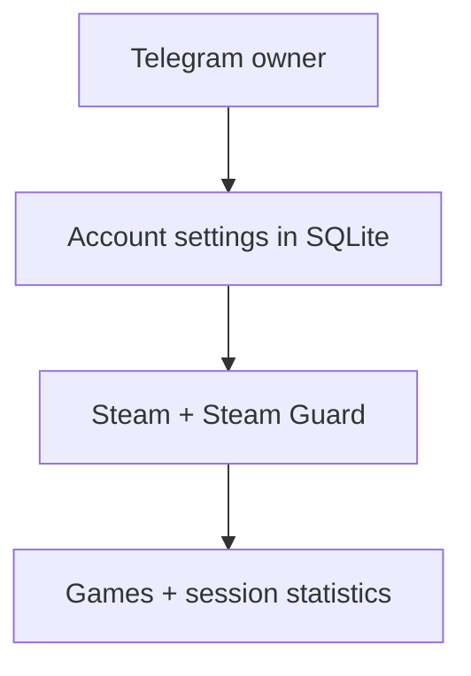

# 🎮 Steam Hour Booster

> Telegram-панель для управления Steam-аккаунтами: запуск игр, Steam Guard, автоматическое переподключение и учёт времени сессий.

🌐 **Language / Язык:** [English](README.md) · [Русский](README_RU.md)


## 📌 Обзор

Steam Hour Booster — Telegram-бот для управления Steam-аккаунтами: запускает выбранные игры, принимает коды Steam Guard и ведёт учёт времени сессий. Доступ ограничен владельцем; настройки и статистика хранятся в SQLite.

> [!WARNING]
> Пароли и токен бота хранятся в базе в **открытом виде**. См. [Безопасность и приватность](#-безопасность-и-приватность).

> [!NOTE]
> Интерфейс доступен на английском (по умолчанию) и русском языках: переключается кнопкой 🌐 на главном экране ([подробнее](#язык)).

## ✨ Возможности

- Управление аккаунтами целиком через Telegram: добавление, редактирование, удаление с подтверждением.
- Запуск и остановка игр по App ID; названия игр загружаются из Steam и кэшируются.
- Вход через Steam AuthenticationService: подтверждение в приложении Steam или код Guard/email через бота.
- Автоматическое переподключение при потере связи со Steam (например, из-за VPN): бот сам возвращает сессию, пока вы не нажмёте «Остановить».
- Автоматические коды Steam Guard: по `shared_secret` из `.maFile` бот сам вводит мобильный код ([подробнее](#-автоматический-steam-guard)).
- Автозапуск: после перезапуска бота или ПК аккаунты, которые работали и не были остановлены вручную, запускаются сами.
- Кастомное название в статусе Steam (отображается как сторонняя игра перед настроенными App ID).
- Статистика по каждому аккаунту и история завершённых сессий.
- Уведомления владельцу о долгом обрыве связи и его восстановлении, о необходимости ввести код и об остановке сессии по причине.
- Устойчивое обновление карточки: повторные попытки после временных сетевых ошибок Telegram.

## 🏗️ Как это работает



- **Учёт времени.** Локальный timer начинается только после `EResult.OK` от Steam. При обычной остановке или disconnect длительность добавляется в `total_boost_seconds`, а session помечается завершённой.
- **Прерывания.** При прерывании игры учёт времени приостанавливается, а подключение к Steam сохраняется. Выход из игры определяется после подтверждённого Steam игрового статуса. Видимость профиля и настройки приватности для этой проверки не используются. Если после переподключения аккаунт играет на другом устройстве, карточка показывает «⏸️ Игра прервана», а бот пытается возобновить игру, когда Steam освободит аккаунт (поведение зависит от Steam).
- **Переподключение.** При потере связи со Steam бот переподключается сам с экспоненциальной паузой от 2 до 60 секунд (с небольшим случайным разбросом), пока вы не нажмёте «⏹️ Остановить». Первые попытки используют refresh token, который хранится **только в памяти** процесса: в SQLite он не записывается и сбрасывается при выходе из программы или при смене логина/пароля аккаунта. Поэтому для обычных обрывов код Guard не нужен. Если Steam отклонил токен, бот входит заново по логину и паролю. Если у аккаунта сохранён `shared_secret` и Steam запросил мобильный код, бот сам сгенерирует и введёт его (при отказе повторит в следующем 30-секундном окне, до 3 раз; локальные часы сверяются со временем Steam). Коды из email и подтверждения в приложении автоматизировать нельзя: тогда бот присылает уведомление и ждёт. При переподключении лимита в 5 минут нет; он действует только для ручного первого запуска.
- **Когда автопереподключения нет.** Бот намеренно не переподключается, если Steam сообщил, что аккаунт вошёл в другом месте (сессию забрал другой клиент: переподключение выбило бы вас из вашего же Steam), при ошибках Steam вроде неверного пароля или блокировки аккаунта (ошибка + уведомление, запустите вручную) и после ручной остановки. Если Steam ограничивает частоту входов (EResult 84/87), бот ждёт не меньше 5 минут.
- **Учёт при обрывах.** Время простоя не засчитывается, и каждое переподключение создаёт новую запись сессии.
- **Автозапуск.** Бот помнит аккаунты, которые вы запустили кнопкой «🚀 Запустить» и не останавливали вручную («⏹️ Остановить»); после перезапуска бота (в том числе перезагрузки ПК) они стартуют сами. Токен после перезапуска пропал, поэтому нужен код: с `shared_secret` бот введёт его сам, без него пришлёт уведомление «Для входа нужен код…» и будет ждать без лимита в 5 минут. Если аккаунт в этот момент играет на другом устройстве, он ждёт в статусе «⏸️ Игра прервана», а не уходит в ошибку. Аккаунт, остановленный из-за ошибки (неверный пароль, вход на другом устройстве), в автозапуск не попадает, пока вы не запустите его снова. Выключить автозапуск аккаунта — нажать «⏹️ Остановить» перед закрытием бота.
- **Уведомления.** Бот отправляет владельцу отдельное сообщение (открытая карточка остаётся на месте): если обрыв длится дольше ~90 секунд (не чаще раза в 30 минут на аккаунт) и после него — «восстановлено»; когда нужен код вручную; когда сессия остановлена по причине. Причина также пишется в консоль. Ручная остановка и штатное закрытие скрипта уведомлений не вызывают. При временной недоступности Telegram отправка повторяется.
- **Кастомная игра.** Остановите аккаунт, откройте **Настройки → 🎮 Кастомная игра**, введите одну строку до 64 символов и снова запустите аккаунт. Название отправляется первым как сторонняя игра, затем идут настроенные App ID в исходном порядке. У каждого аккаунта своё название; **Убрать кастомную игру** возвращает обычный список. Это статус стороннего приложения: `.exe` не запускается, библиотечные игры не переименовываются. Видимость по-прежнему определяют настройки приватности Steam ([инструкция Steam о сторонних играх](https://help.steampowered.com/en/faqs/view/4B8B-9697-2338-40EC)).

> [!WARNING]
> При обычной остановке бот завершает Steam workers и фиксирует время сессий. При аварийном завершении, если в SQLite остаётся `active_since`, следующий запуск закрывает такую session своим текущим временем, поэтому downtime между остановкой процесса и следующим запуском может попасть в статистику. Эти значения — локальный учёт работы бота, а не независимая или гарантированно точная Steam playtime.

## 🚀 Быстрый старт

### Требования

- Python 3.14;
- Telegram-бот, созданный через [@BotFather](https://t.me/BotFather);
- числовой Telegram ID владельца;
- Steam-аккаунты, которыми вы вправе управлять;
- системная среда, в которой устанавливается `steam[client]`.

### Установка

```powershell
git clone https://github.com/soroka01/HourBooster.git
cd HourBooster
```

### Настройка

Файл `.env` не нужен. При первом запуске выберите язык интерфейса (английский или русский), введите токен Telegram-бота и ID владельца в консоли; они сохранятся в SQLite. Steam-аккаунты добавляются через Telegram.

### Запуск

Windows: [start.bat](start.bat) создаёт `.venv`, устанавливает зависимости и запускает бота.

```powershell
.\start.bat
```

Ручной эквивалент:

```powershell
python -m venv .venv
.\.venv\Scripts\python.exe -m pip install -r requirements.txt
.\.venv\Scripts\python.exe HourBooster.py
```

Linux и macOS:

```bash
python3 -m venv .venv
.venv/bin/python -m pip install -r requirements.txt
.venv/bin/python HourBooster.py
```

## 🛡 Автоматический Steam Guard

`shared_secret` — секрет мобильного аутентификатора Steam, из которого считаются коды Guard. С ним бот сам вводит код при входе и переподключении, и вам не нужно открывать приложение Steam.

**Как получить `shared_secret`**

1. Скачайте [steamguard-cli](https://github.com/dyc3/steamguard-cli/releases) — на Windows это файл `steamguard-windows-x86_64.exe` (проект развивается; Steam Desktop Authenticator заброшен и с новым входом Steam часто не получает код подтверждения).
2. В PowerShell, в папке с файлом, выполните `.\steamguard-windows-x86_64.exe setup`. Введите логин и пароль аккаунта, код Steam Guard из письма (если Steam его запросит) и в конце код подтверждения: Steam присылает его по SMS на привязанный номер или на почту аккаунта, программа сама пишет, куда именно. Привязанный телефон для этого больше не обязателен. Не запускайте `setup` много раз подряд: у Steam есть лимиты на попытки.
3. **Запишите код восстановления (R12345)**, который программа покажет в конце, и храните его офлайн.
4. Повторите для каждого аккаунта. Файлы `<steamid>.maFile` лежат в `%APPDATA%\steamguard-cli\maFiles\`: сделайте их копию и не шифруйте (команду `encrypt` не запускайте), бот не читает зашифрованные файлы.

У аккаунта может быть только один мобильный аутентификатор: приложение Steam на телефоне перестанет выдавать коды. Если аутентификатор уже подключён, `setup` предложит перенести его (по SMS) или снять по коду восстановления. После подключения нового аутентификатора Steam может на время ограничить обмены и торговую площадку.

**Как передать боту**

- Один аккаунт: **✏️ Настроить → 🛡 Steam Guard secret** — отправьте `shared_secret`, весь текст `.maFile` или загрузите `.maFile` документом (до 64 КБ). Если в файле указан другой логин Steam, бот откажет. Кнопка **✖️ Убрать Guard secret** возвращает ручной ввод кодов.
- Много аккаунтов сразу: на главном экране нажмите **🛡 Импорт Guard (maFile)** и отправьте сразу несколько `.maFile` документами (папка `%APPDATA%\steamguard-cli\maFiles\`). Бот сопоставит `account_name` каждого файла с сохранённым логином Steam и включит автокод; итог по файлам показывается на экране.

После настройки steamguard-cli **не нужно держать запущенным**: бот считает коды сам (файлы `.maFile` сохраните как резервную копию). Подойдут и файлы из Steam Desktop Authenticator, если они у вас уже есть. В карточке аккаунта строка «🛡 Steam Guard» показывает «авто» или «вручную».

## ⚙️ Конфигурация

Настройки Telegram хранятся в таблице `app_settings` той же SQLite-базы, что и аккаунты. Для изменения токена или ID владельца остановите бота и выполните:

```powershell
.\.venv\Scripts\python.exe HourBooster.py --setup
```

Токен вводится открыто; его можно вставить через Ctrl+V. После сохранения команда завершится; запустите бота обычным способом.

**Параметры командной строки**

| Параметр | По умолчанию | Описание |
| --- | --- | --- |
| `--setup` | выкл. | Сохранить язык интерфейса и настройки Telegram (токен, ID владельца) в SQLite и выйти |
| `--database PATH` | `data/hour_booster.sqlite3` (относительно каталога проекта) | Использовать другую SQLite-базу; работает вместе с `--setup` |

### Язык

Язык интерфейса — настройка в той же базе SQLite (`app_settings`, ключ `language`): `en` (английский, по умолчанию) или `ru` (русский). Он действует на всё, что показывает программа: экраны бота, кнопки, уведомления, сообщения об ошибках, меню команд и вывод в консоль. Названия игр загружаются из Steam на том же языке.

- В Telegram: нажмите кнопку **🌐 Русский** / **🌐 English** на главном экране. Переключение сразу применяется везде и сохраняется.
- В консоли: первый вопрос `HourBooster.py --setup` предлагает `en` или `ru`.
- База, созданная до появления этой настройки, стартует на английском.

**Команды бота**

| Команда | Действие |
| --- | --- |
| `/start` | Открыть список аккаунтов |
| `/menu` | Открыть список аккаунтов |
| `/cancel` | Отменить форму или ввод auth code |

**Карточка аккаунта**

```text
/start
  └─ список аккаунтов
       ├─ ➕ добавить аккаунт
       ├─ 🛡 импорт Guard (maFile)
       ├─ 🌐 язык (English / Русский)
       └─ открыть карточку
            ├─ 🚀 запустить / ⏹ остановить
            ├─ 🔐 ввести Steam Guard или email code
            ├─ 📊 статистика
            ├─ ✏️ изменить название, login, пароль, Guard secret, App ID или кастомную игру
            └─ 🗑 удалить с подтверждением
```

**Обновление:** сохраните резервную копию SQLite, выполните `git pull` и перезапустите бота. Существующие аккаунты и статистика остаются в БД. Импорт аккаунтов из INI удалён.

## 🗂️ Структура проекта

```text
HourBooster.py          # точка входа, аргументы CLI (--setup, --database)
start.bat               # запуск в Windows: .venv, зависимости, старт
requirements.txt        # aiogram, steam[client]
src/
├── config_manager.py   # работа с настройками Telegram
├── i18n.py             # язык интерфейса и функция t()
├── locales/            # каталоги сообщений: английский и русский
├── bot/                # Telegram-слой: контроллер, UI, состояния, проверка доступа, уведомления
├── steam/              # вход в Steam, управление сессиями, названия игр
│   └── guard.py        # shared_secret, коды Steam Guard, время Steam
└── storage/            # база данных SQLite
data/                   # SQLite-база времени выполнения (создаётся при запуске)
```

## 🔒 Безопасность и приватность

SQLite по умолчанию находится в `data/hour_booster.sqlite3` и содержит:

- токен Telegram-бота и ID владельца;
- названия аккаунтов, Steam logins и **plaintext passwords**;
- `shared_secret` (если задан) в открытом виде рядом с паролем;
- списки App ID и кастомные названия игр;
- суммарное время и отметку `active_since`;
- историю завершённых sessions;
- ID control message для каждого Telegram chat.

Рекомендации:

- ограничьте доступ к каталогу проекта средствами операционной системы;
- не помещайте базу в публичные backups;
- отзовите Telegram token при подозрении на утечку;
- не полагайтесь на удаление messages как на единственную защиту credentials;
- `shared_secret` достаточно, чтобы генерировать коды Steam Guard, поэтому относитесь к базе как к секрету;
- Telegram удаляет присланное сообщение или файл с `.maFile` лишь по возможности, а серверы Telegram уже могли его видеть, поэтому отправляйте секрет только в личном чате с ботом;
- перед удалением аккаунта сделайте backup, если нужна его статистика.

Пароль передаётся Steam в RSA-зашифрованном виде, затем Steam-клиент входит по refresh token. Refresh token хранится только в памяти (в SQLite не записывается и сбрасывается при выходе из программы), не выводится в сообщения. `shared_secret` тоже нигде не показывается и не пишется в логи.

## ⚠️ Ограничения

- Обновляется только открытая карточка с интервалом не меньше 2 секунд.
- Названия игр загружаются из Steam и кэшируются; при недоступности названия отображается ID. Длинные названия сокращаются до лимита сообщения.
- При ручном первом запуске подтвердите запрос Steam Hour Booster в приложении Steam или введите код через бота в течение 5 минут. При автоматическом переподключении этого лимита нет.
- Коды из email и подтверждения в приложении Steam нельзя автоматизировать: бот присылает уведомление и ждёт.
- Доступность входа зависит от Steam; семейные ограничения на игры продолжают действовать.

### Решение проблем

| Симптом | Что проверить |
| --- | --- |
| Ошибка конфигурации | Повторите `HourBooster.py --setup` |
| Нет доступа к боту | Совпадает ли Telegram ID с настройками SQLite |
| Steam отклоняет login | Credentials и требуемый Guard/email code |
| Сессия остаётся в `connecting` | Network access, Steam availability и logs в консоли |
| `steamguard-cli setup` ждёт SMS-код, а он не приходит | Это сторона Steam и оператора: на российские номера SMS бывают недоставляемы. Подождите 15–30 минут, не нажимайте Enter подряд и не закрывайте окно. Если код не пришёл, уберите номер с аккаунта (Steam → Данные аккаунта → Номер телефона; при отсутствии доступа к номеру — форма поддержки Steam) и повторите `setup`: Steam пришлёт код на почту. Код восстановления R… записывайте до подтверждения |
| Автокод Steam Guard не принят | Принадлежит ли `shared_secret`/`.maFile` именно этому аккаунту, точность часов компьютера; подождите следующее 30-секундное окно |
| Аккаунт постоянно переподключается | Нестабильность VPN или сети; смотрите логи. Уведомление об обрыве приходит через ~90 секунд |
| Вход выполнен на другом устройстве | Steam забрал сессию другому клиенту; бот не переподключается сам, запустите аккаунт вручную |
| `TelegramNetworkError` / `ServerDisconnectedError` при обновлении экрана | Это связь с Telegram. Бот повторяет обновление с паузой до 60 секунд и пишет о восстановлении в консоль; Steam-сессии не перезапускаются. При лимите Telegram учитывается `retry_after` |
| Статистика выросла после restart | Ограничение recovery незакрытой session выше |
| Не ставится `steam[client]` | Python version и platform build dependencies |

## 📄 Лицензия

[GNU GPL v3.0](LICENSE). Версии, опубликованные до смены лицензии, остаются под MIT.

## 💬 Поддержка

Можно [форкнуть репозиторий](https://github.com/soroka01/HourBooster/fork) и доработать под себя. Если проект пригодился, поставьте [Star](https://github.com/soroka01/HourBooster) — так я увижу, что он был кому-то полезен.

---

with love ❤️
